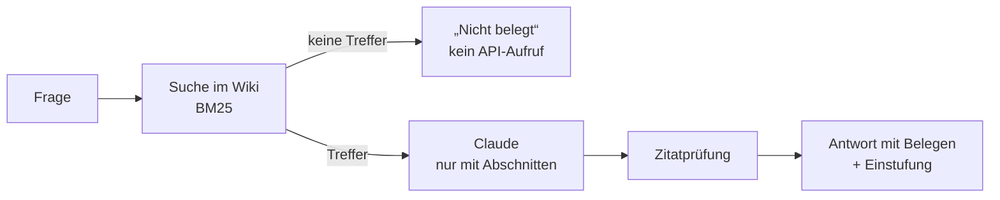

<div align="center">



<br>

[](https://github.com/Extrutex/am-wiki-agent/actions/workflows/checks.yml)

**[Zum Wiki](https://extrutex.github.io/am-wiki-agent/)** · **[Schnellstart](#schnellstart)** · **[Wie es funktioniert](#wie-es-funktioniert)** · **[Sicherheit](#sicherheit)**

</div>

<br>

Next-Gen-Wiki mit Chat-Agent für 3D-Druck-Firmware. **Jede Aussage hat eine Quelle, jedes Beispiel ist getestet, und der Agent rät nicht:** Ohne passenden Wiki-Abschnitt wird Claude gar nicht erst gefragt.


## Was drin steckt

| | |
|---|---|
| 📚 **Belegtes Wiki** | Artikel in Deutsch und Englisch mit Quellen, Abrufzeit, SHA-256 und Prüfdatum. Erstes Kapitel: *Klipper-Makros und Jinja2*. |
| 💬 **Chat-Agent** | BM25-Suche über Wiki-Abschnitte, Antwort nur mit Zitaten, Zitate werden geprüft. Eigene Schlüssel der Nutzer werden unterstützt. |
| 🛠️ **Config-Editor** | Der Agent schlägt Änderungen an der `printer.cfg` vor, mit Diff und Belegen. Eingespielt wird nichts, das tust du selbst. |
| 🔒 **Pin-Schutz** | Pins und Gerätekennungen sind im Code gesperrt. Änderung nur mit ausdrücklicher Anforderung **und** Bestätigungssatz. |
| 🧪 **Getestete Beispiele** | Makro-Beispiele werden mit Klippers Jinja2-Einstellungen gerendert. Wiki und Dateien müssen übereinstimmen. |
| 🚦 **Kostengrenzen** | Rate-Limit pro IP und Tagesbudget an Tokens für den Server-Schlüssel. |

## Wie es funktioniert



Einstufung: **bestätigt** (alle Belege gültig, Artikel bestätigt, keine Warnungen), **offen** (Hinweise offen) oder **nicht belegt**. In der API heißen die Werte `bestaetigt`, `offen` und `nicht_belegt`.

## Schnellstart

Python 3; für Makro-Tests wird Jinja2 gebraucht.

```bash
python3 -m venv .venv && .venv/bin/pip install -r requirements-dev.txt
.venv/bin/python am_validate.py                       # Register, Spezifikation, Wiki prüfen
.venv/bin/python -m unittest discover -s tests -t .   # Offline-Tests
```

**Chat-Agent starten**

```bash
cp .env.example .env      # ANTHROPIC_API_KEY=… eintragen (.env ist nicht in Git); oder: ant auth login
.venv/bin/uvicorn am_agent.server:app --port 8791   # dann http://localhost:8791
```

Modell über `AM_MODEL` (Standard `claude-sonnet-5-5`). **Jede Frage kostet Geld auf deinem API-Konto.** Nutzer können im Chat auch einen eigenen Anthropic-Schlüssel eintragen (Header `X-Anthropic-Key`): Er gilt nur für die Anfrage, wird nicht gespeichert oder geloggt und bleibt im Browser-Tab.

**Quellen abrufen**

```bash
python3 am_research_builder.py --list                    # Quellen anzeigen
python3 am_research_builder.py --only klipper-releases   # echter Abruf (nur HTTPS-GET)
```

**Statische Seite bauen** (GitHub Pages): `python build_pages.py` erzeugt `site/`. Mit `AM_CHAT_API=<Worker-Adresse>` bekommt jede Seite das Chat-Fenster unten rechts.

**Chat im Netz:** Der Chat auf der Seite läuft über einen Cloudflare Worker (`worker/`) mit deinem Anthropic-Schlüssel, 5 Gratisfragen pro Besucher und Tag, danach Spendenhinweis. Einrichtung in [worker/README.md](worker/README.md).

## Kostengrenzen

Gelten für den Server-Schlüssel, Anfragen mit eigenem Nutzer-Schlüssel zählen nicht.

| Einstellung | Standard |
|---|---|
| `AM_RATE_PRO_MIN` | 5 Anfragen pro Minute und IP |
| `AM_RATE_PRO_TAG` | 40 Anfragen pro Tag und IP |
| `AM_TAGESBUDGET_TOKENS` | 300000 Tokens pro UTC-Tag, alle Nutzer zusammen |
| `AM_TRUST_PROXY=1` | `X-Forwarded-For` gilt, nur wenn dein Proxy ihn selbst setzt |

Gezählt wird nach der Antwort, ein Aufruf kann das Budget also um seine eigene Größe überschreiten. Gespeichert werden nur Zähler in `.usage.json`, keine Fragen, Schlüssel oder IPs. `GET /api/health` zeigt `kontingent: frei|leer`. **Setze zusätzlich ein Spend-Limit in der Anthropic-Console, das ist die einzige harte Obergrenze.**

## Sicherheit

- **Pins gesperrt:** Jede Änderung an `*_pin`, `pin`, `pins`, `adc1`, `adc2`, `serial`, `canbus_*`, `[board_pins]` und `[include]` blockt der Server, auch im `SAVE_CONFIG`-Block. Ändert der erste Vorschlag einen Pin, fragt der Server einmal nach und verwirft sonst alles. Freigabe nur mit ausdrücklicher Anforderung und dem Satz „Ich weiß was ich tue“.
- **Nichts passiert automatisch:** keine Firmware-Updates, keine Druckerbefehle, keine Zahlungen, keine Veröffentlichung. Das Skript liest nur, Makros werden nur gerendert, Workflows haben nur `contents: read` (Pages zusätzlich `pages: write`).
- **Schlüssel** stehen nur in der Umgebung oder in `.env`, nie im Browser-Code oder in Git.

## Wiki erweitern

- Artikel werden **neu aus Primärquellen geschrieben**, fremde Guides werden nicht kopiert.
- Status „bestätigt“ (Wert `bestaetigt`) nur mit Quelle und Abruf unter `knowledge-base/fetched/`.
- Jeder Artikel existiert in `de` und `en` mit gleichen Quellen und Beispielen.
- Codeblöcke mit `<!-- beispiel: datei -->` müssen mit der Datei in `wiki/beispiele/` übereinstimmen.
- Neue Quelle: Eintrag in `knowledge-base/sources.json` (Host in `allowed_hosts` ergänzen), dem Agenten in `am_specialist_spec.json` zuordnen, `am_validate.py` ausführen.

**Datenklassen:** „bestätigt“ gibt es nur mit Quelle und Abruf. „Beispiel“ (Wert `beispiel`) sind Demodaten und nie als Fakt zu verwenden.

## Aufbau

| Pfad | Zweck |
|---|---|
| `am_agent/` | Chat-Agent: Suche, Claude-Aufruf mit Zitatprüfung, Pin-Schutz (`cfg_guard.py`), Limits, FastAPI-Server, Oberfläche (`static/`) |
| `wiki/de`, `wiki/en`, `wiki/beispiele/` | Zweisprachige Artikel und getestete Beispieldateien |
| `knowledge-base/` | Quellenregister (`sources.json`) und echte Abrufe (`fetched/`) |
| `am_research_builder.py` | Ruft Websites und GitHub-Releases aus dem Register ab, speichert Zeit, URL, SHA-256, Status |
| `am_specialist_spec.json`, `am_validate.py` | Versionierte Spezifikation und ihre Offline-Prüfung |
| `klipper_macro_check.py`, `wiki_tools.py` | Makro-Lint und Test-Rendering, Wiki-Validierung |
| `agents/` | Koordinator, Firmware, Hardware/Toolchanger, Quellenprüfung, B2B |
| `build_pages.py` | Baut die statische Seite für GitHub Pages inklusive Sitemap, Meta-Tags und Chat-Fenster |
| `worker/`, `build_worker.py` | Chat-API als Cloudflare Worker: Suche, Zitatprüfung, Gratisfragen, Tagesbudget |
| `tests/`, `.github/workflows/` | Offline-Tests, Prüfungen, Pages-Deploy, wöchentliche Recherche (nur Artefakt) |

## Stand und Planung

- [x] Wiki-Grundlage, erstes Kapitel Klipper-Makros/Jinja2 (de/en)
- [x] Chat-Agent mit Zitatprüfung, eigener Schlüssel, Kostengrenzen
- [x] Config-Editor mit Pin-Schutz
- [x] Statische Seite mit SEO (Sitemap, hreflang, strukturierte Daten)
- [ ] Weitere Kapitel: Klipper-Doku, RepRapFirmware, Marlin, Bambu Lab, Prusa
- [x] Chat im Netz: Cloudflare Worker, Chat-Fenster auf jeder Seite, Gratisfragen mit Spendenhinweis
- [ ] Worker veröffentlichen und Spendenlink eintragen
- [ ] Spenden- und Bezahlmodell, falls Nachfrage da ist

Lizenz: noch nicht festgelegt.
